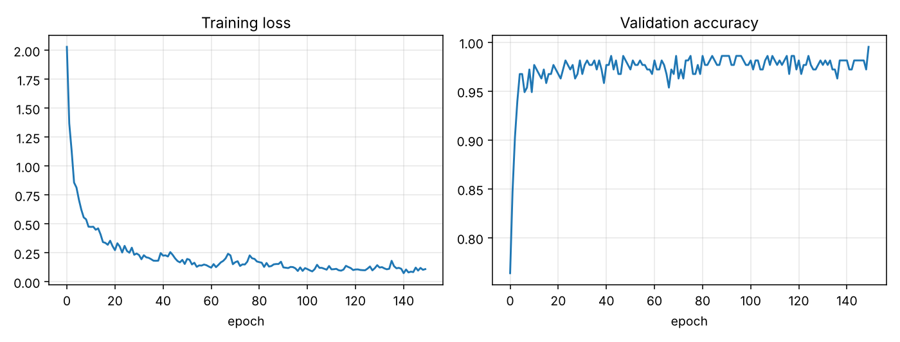
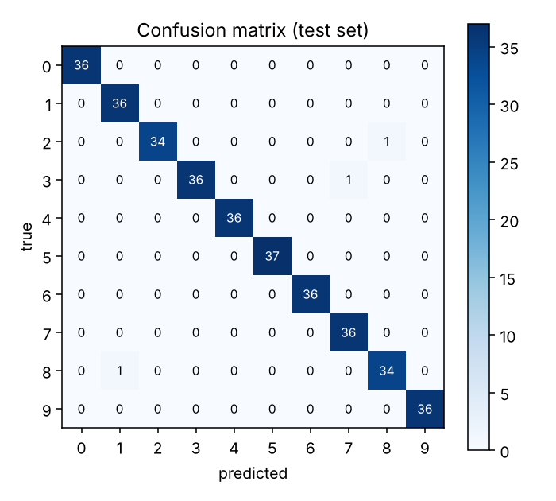

# DigitNet: a neural network from scratch in NumPy

A small neural network library written from scratch in NumPy (no PyTorch or TensorFlow), trained to recognize handwritten digits, with a browser demo where you draw a digit and the network guesses it live.

The goal was to understand what deep learning frameworks actually do under the hood: forward passes, backpropagation, and optimizers like Adam. That meant implementing them myself and checking the math with numerical gradient tests.

[**Live demo: draw a digit**](#demo) · 99.2% test accuracy · trains in \~2 seconds on a laptop CPU



## Results

Test set: 360 held-out images from the scikit-learn digits dataset (8×8 grayscale).

| Model                                                | Test accuracy |
|------------------------------------------------------|---------------|
| Logistic regression (scikit-learn)                   | 96.7%         |
| MLP, same layer sizes (scikit-learn `MLPClassifier`) | 97.2%         |
| **DigitNet (this repo)**                             | **99.2%**     |

Across different random seeds (which also change the train/test split) DigitNet scored 98.9–99.2%. The main gain over the scikit-learn MLP comes from **data augmentation** (randomly shifting images by one pixel) plus **dropout**. Without augmentation, the from-scratch network performs about the same as scikit-learn's, which is a good sign the core math is correct.



## What's implemented

| File | What it does |
|------------------------------------|------------------------------------|
| `src/digitnet/layers.py` | `Dense` (fully connected), `ReLU`, `Dropout`, each with a hand-written `forward` and `backward` |
| `src/digitnet/losses.py` | Numerically stable softmax + cross-entropy, using the simplified gradient `(p - y) / N` |
| `src/digitnet/optim.py` | SGD with momentum, and Adam with bias correction and weight decay |
| `src/digitnet/model.py` | `Sequential` container, model builder, and JSON weight export for the demo |
| `tests/test_gradients.py` | Gradient checks that compare backprop with finite differences, plus a sanity test that the net can overfit a tiny batch |
| `train.py` | Training loop with mini-batches, augmentation, best-checkpoint selection, baselines, and plots |
| `demo/index.html` | Draw-a-digit page; reimplements the forward pass in JavaScript using the exported weights |

Architecture: `64 → Dense 128 → ReLU → Dropout → Dense 64 → ReLU → Dropout → Dense 10 → Softmax`

## How to run it

``` bash
pip install numpy scikit-learn matplotlib pytest
python -m pytest          # run gradient checks (4 tests)
python train.py           # train, print metrics, save plots + demo/weights.json
```

Then open the demo locally:

``` bash
cd demo && python -m http.server 8000
# visit http://localhost:8000
```

## Demo {#demo}

The demo crops your drawing to the ink, fits it into a 32×32 box, and averages 4×4 blocks down to 8×8, which is roughly how the original dataset was made. It then runs the same forward pass as the Python code. I checked that the JavaScript version gets the same predictions as the Python one on real dataset images.

## Things I learned / limitations

- **Gradient checking matters.** Comparing backprop against `(f(x+ε) − f(x−ε)) / 2ε` catches small mistakes (a missing transpose, a wrong sum axis) that would otherwise just make training slightly worse without any error.
- **Softmax overflows** if you don't subtract the max first; there's a test for this.
- **Distribution shift:** the network was trained on tidy, centered 8×8 scans, so mouse-drawn digits are harder. Augmentation helped, but very thin or off-center drawings can still fool it.
- **8×8 is tiny.** The next step would be MNIST (28×28) and adding a convolutional layer.
- The validation set is small (216 images), so the "best epoch" selection is a bit noisy.
